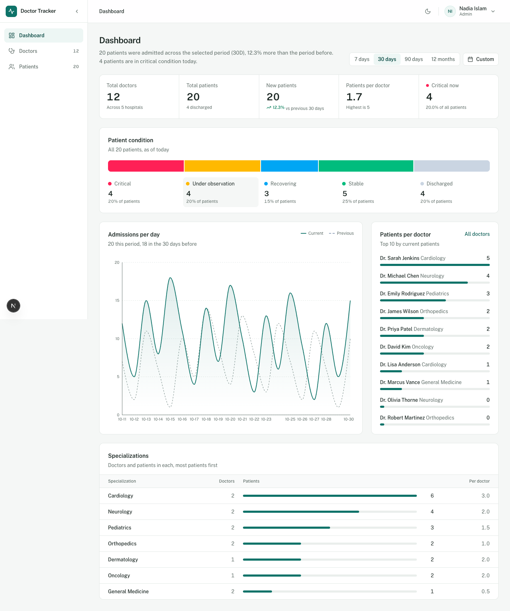
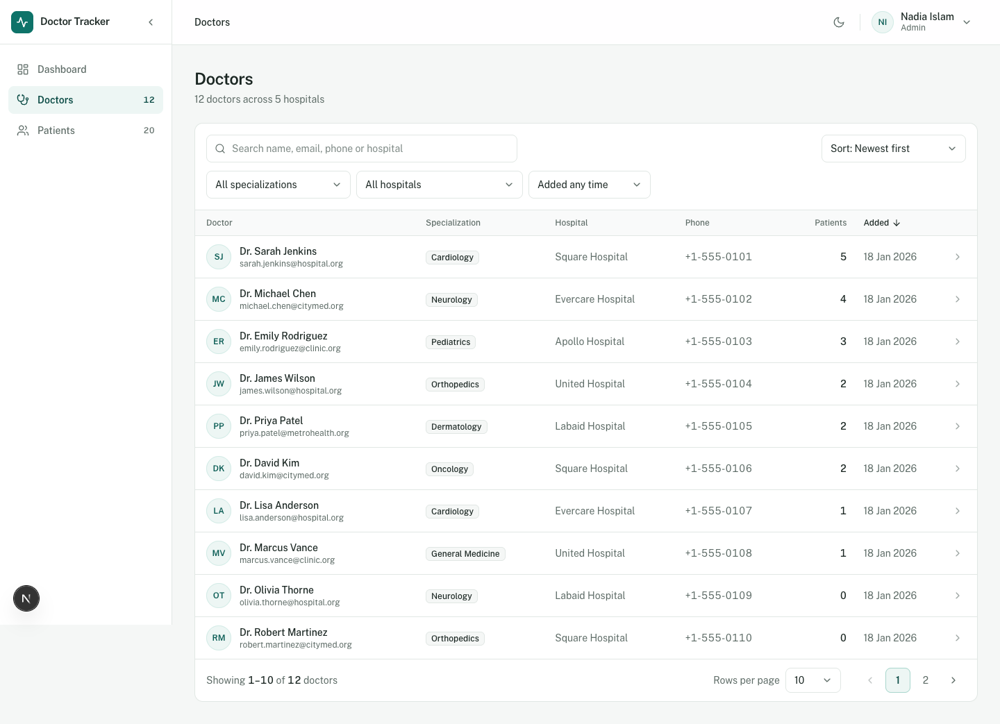
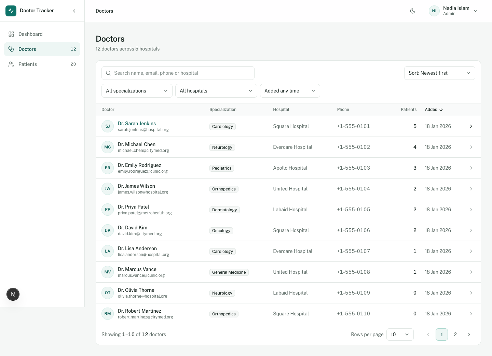
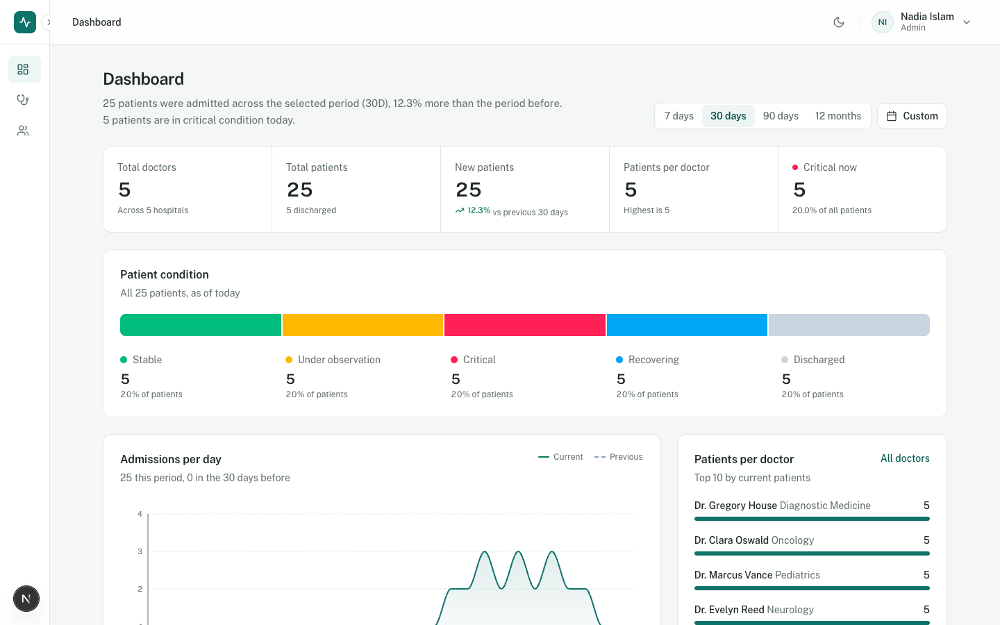
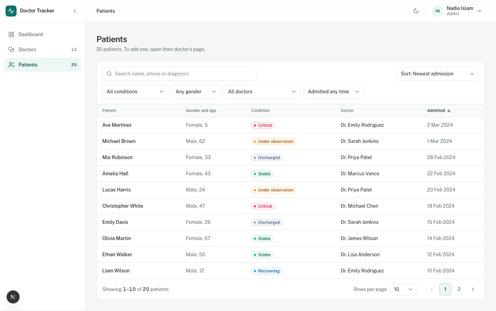
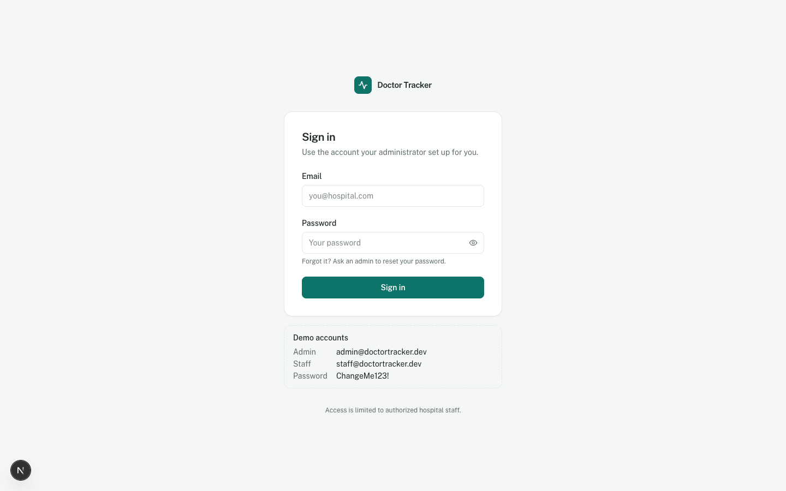

# Doctor Tracker — Clinical Frontend Portal

An enterprise-grade healthcare management portal engineered with **Next.js 16 (App Router)**, **React 19**, **Tailwind CSS**, and **TypeScript**. Built for hospital clinical workflows, physician caseload auditing, and patient tracking with high-performance responsive UI, URL-addressable route modals, and strict role-based access control (RBAC).

---

## UI Preview

| Dashboard & Real-Time Analytics | Doctors Directory & Caseloads |
| :---: | :---: |
|  |  |

| Doctor Caseload & Assigned Patients | Responsive Collapsed Sidebar |
| :---: | :---: |
|  |  |

| Patient Directory & Clinical Filters | Secure Role-Based Authentication |
| :---: | :---: |
|  |  |

---

## Description

**Doctor Tracker** is a clinical physician and patient management platform designed for hospital administrative teams and medical staff. It provides dynamic caseload tracking, real-time admissions analytics, departmental doctor-to-patient allocation ratios, and patient status monitoring across clinical recovery stages. The portal enforces strict zero-database operations from Next.js, proxying all secure data transactions through an Express.js 5 microservice while delivering sub-second partial prerendered views and optimistic UI updates.

---

## Setup Guide

Follow the steps below to run the frontend application locally:

### 1. Prerequisites
- **Node.js**: `v20+` or `v22+`
- **Package Manager**: `pnpm` (`v10+` or `v11+`)

### 2. Install Dependencies
From the `doctor-patient-mgt-frontend` directory:
```bash
pnpm install
```

### 3. Environment Configuration
Create a `.env.local` file by copying the provided `.env.example`:
```bash
cp .env.example .env.local
```

Ensure your `.env.local` matches the following configuration:
```env
# URL of the Express.js Backend API
API_URL=http://localhost:5001

# Public Client Endpoint
NEXT_PUBLIC_API_URL=http://localhost:5001/api/v1

# Branding & Demo Mode
NEXT_PUBLIC_APP_NAME="Doctor Tracker"
NEXT_PUBLIC_SHOW_DEMO_LOGIN=true
```

### 4. Run the Development Server
```bash
pnpm dev
```
Open **[http://localhost:3000](http://localhost:3000)** in your browser.

### 5. Demo Accounts
| Role | Email | Password | Access Level |
| :--- | :--- | :--- | :--- |
| **Admin** | `admin@doctortracker.dev` | `ChangeMe123!` | Full write privileges (Add/Edit/Delete doctors & patients) |
| **Staff** | `staff@doctortracker.dev` | `ChangeMe123!` | Clinical read-only access (Auditing, search, filtering) |

---

## System Architecture

```text
┌────────────────────────────────────────────────────────┐
│               Client Browser (Port 3000)               │
└────────────┬─────────────────────────────▲─────────────┘
             │ Next.js App Router          │ React 19 SSR
             ▼                             │
┌────────────────────────────────────────────────────────┐
│          Next.js 16 Reverse Proxy (Rewrites)           │
│           (/api/v1/*  ──►  http://localhost:5001)      │
└────────────┬─────────────────────────────▲─────────────┘
             │ Same-Origin HTTP Cookies    │ JSON Envelope
             ▼                             │
┌────────────────────────────────────────────────────────┐
│             Express.js 5 API Service (Port 5001)       │
│               [Argon2id, Zod, OpenAPI 3.1]             │
└────────────┬─────────────────────────────▲─────────────┘
             │ Mongoose ODM / Transactions │
             ▼                             │
┌────────────────────────────────────────────────────────┐
│              MongoDB Atlas Cloud Database              │
└────────────────────────────────────────────────────────┘
```

1. **Same-Origin Secure Cookie Boundary**:
   Browser requests are dispatched to same-origin paths (`/api/v1/*`). Next.js Turbopack reverse proxy rewrites forward them to the Express backend. This guarantees `httpOnly`, `SameSite=Lax` auth cookies are exchanged securely without cross-origin cookie rejection or client-side JavaScript exposure.
2. **Server-Side Data Requests**:
   Following strict architectural boundaries, Next.js performs **zero direct database connections**. Server Components and route proxies interact exclusively with the backend via authenticated HTTP requests (`serverApiFetch`).
3. **Role-Based Client Rendering**:
   Client features consume the user context (`useCurrentUser()`). Clinical staff see an audited, clean read-only view with mutation triggers (Add/Edit/Delete) completely stripped from the DOM.

---

## Technical Decisions

### Decision 1: Zustand (Local UI) + TanStack Query (Server State) instead of Redux
* **Context**: The application requires responsive search filtering, interactive sidebar states, and synchronization with doctor/patient backend records.
* **Why Not Redux**: Traditional Redux (even Redux Toolkit) introduces boilerplate, verbose action dispatches, and conflates ephemeral UI state with remote server caching.
* **Our Approach**:
  - **Zustand** is used strictly for lightweight, cross-component UI state (sidebar collapsed/expanded layout state).
  - **TanStack Query (React Query)** manages all server state, providing automatic stale-while-revalidate caching, request deduplication, optimistic updates, and background refetches.
  - **URL Search Parameters (`useSearchParams`)** acts as the single source of truth for all filters, sorting, and pagination, making every list state shareable and bookmarkable.

### Decision 2: URL-Addressable Parallel & Intercepting Routes for Modals
* **Context**: Adding and editing doctors (`/doctors/new`, `/doctors/[id]/edit`) and patients (`/doctors/[id]/patients/new`, `/patients/[id]/edit`) could have been built as basic React modal state (`isOpen`, `setIsOpen`).
* **Why We Used Route Interception**:
  - **Deep-linking & Refresh Support**: Sharing a link like `/doctors/new` or refreshing the page renders a standalone, full-page fallback form without breaking the user's flow.
  - **Smooth Soft Navigation**: Client-side navigation intercepts the route into a `@modal` parallel slot, overlaying the form over the background view with backdrop blur.
  - **Browser Back Button Integration**: Pressing the browser's Back button or Escape closes the modal naturally by triggering `router.back()`, avoiding modal trapping.

---

## Testing & Quality Assurance

- **End-to-End Testing**: Built with **Playwright** (`@playwright/test`) covering authentication flows, parallel modal navigation, and responsive layouts.
- **Type Safety**: TypeScript strict mode with 100% type coverage and zero compile warnings (`pnpm typecheck`).
- **Code Standards**: ESLint 9 + Next.js core Web Vitals rules (`pnpm lint`).
